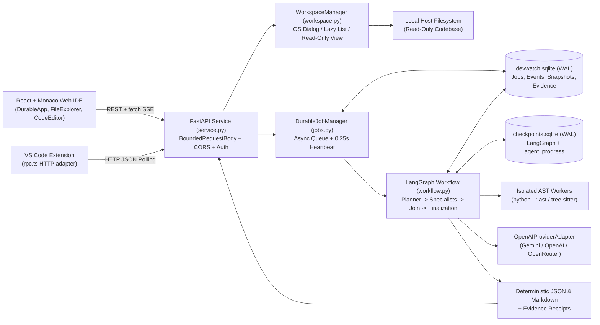
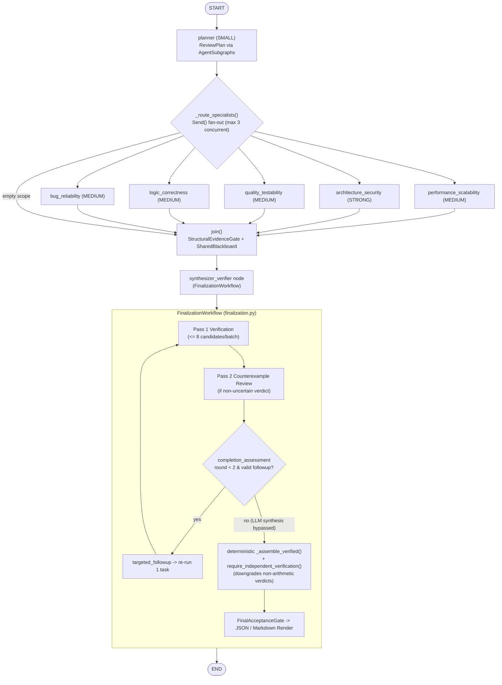
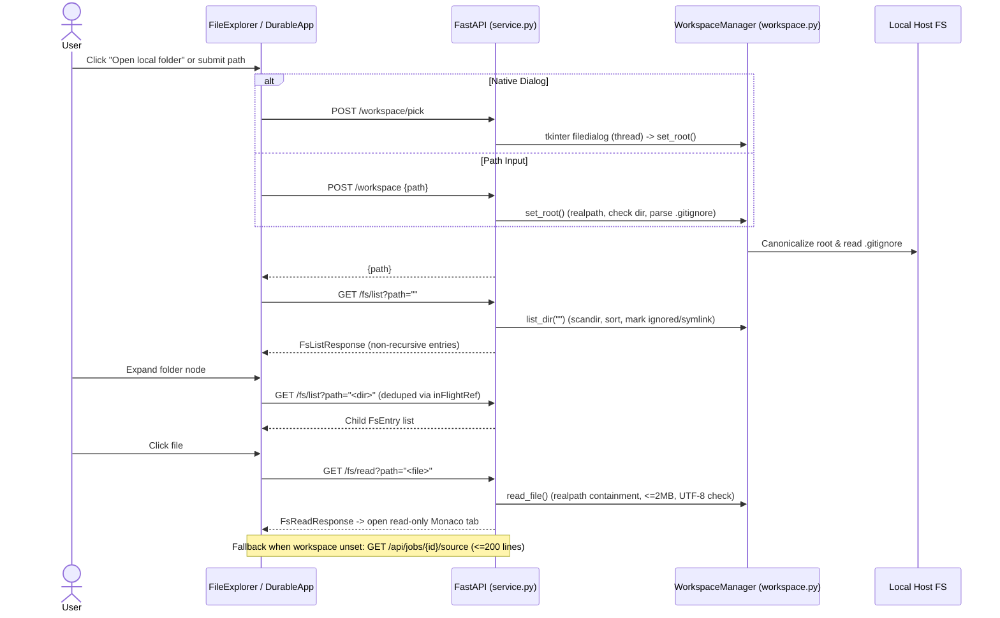
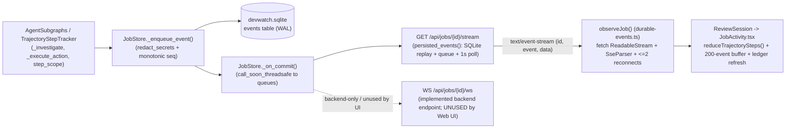

# DeWatch — Complete Technical Audit Report

**Audit Date:** 2026-11-17  
**Repository Root:** `e:\dewatch`  
**Audit Scope:** Strict read-only inspection of the current codebase, tests, configuration, frontend, backend, IDE extensions, and build artifacts on disk.

**Status Classifications Used:**
- `IMPLEMENTED`: Fully implemented in source and verified through direct inspection/execution.
- `PARTIALLY IMPLEMENTED`: Present in source, but has functional defects, missing wiring, unstyled elements, or policy/runtime gaps.
- `NOT IMPLEMENTED`: Absent from the codebase or stubbed without executable implementation.
- `UNVERIFIED`: Source exists, but runtime behavior could not be verified (e.g., blocked by current package rename breakage or not executed in this audit).

---

## 1. Executive Summary

DeWatch is a local-first, read-only agentic code-review service and web IDE built with a Python/FastAPI backend, dual SQLite WAL stores, LangGraph workflow orchestration, and a React + Monaco + `react-arborist` browser frontend. Rather than modifying repository source files or executing arbitrary project scripts inside an unrestricted sandbox, DeWatch runs a fixed **seven-agent contract** (`planner`, five parallel specialists, and `synthesizer_verifier`) over immutable snapshots and read-only workspaces, gating every candidate claim on SHA-256 evidence references and streaming persisted activity over SSE/WebSockets.

Direct inspection of the repository on disk identified **five foundational realities and critical defects**:

1. **Working-Tree Package Rename Breakage (`devwatch` -> `backend`):** The Python package directory on disk is currently `backend/`, while `git status` marks all 28 tracked `devwatch/` files deleted and `backend/` untracked. However, `pyproject.toml` (`include = ["devwatch*"]`), **68 imports inside `backend/`**, **23 import lines in `scripts/`**, `README.md`, and **73 test files in `tests/`** still import `devwatch.*`. As a result, `importlib.util.find_spec('devwatch')` returns `None`, and `pytest --collect-only` fails with **68 collection errors (`ModuleNotFoundError: No module named 'devwatch'`)**.
2. **All Canonical Findings Are Forced Into `uncertain_high_impact_candidates`:** `workflow.py` hardcodes `require_independent_support=True` on `AgentSubgraphs` and `FinalAcceptanceGate`. Because only finite-domain integer arithmetic proofs exist (`backend/review/arithmetic.py`) and no independent whole-claim proof adapter is implemented, `require_independent_verification()` (`backend/review/verification.py`) downgrades every `confirmed`, `advisory`, and non-arithmetic `rejected` decision from `synthesizer_verifier` to `verdict="uncertain"` (`confidence <= 0.5`). Consequently, canonical runs always emit empty `confirmed_defects` and `advisories` lists, keeping raw two-pass verifier verdicts only inside `verification_audit.review_observations`.
3. **Frontend Styling & Mobile Breakage:** `FileExplorer.tsx` and `CodeEditor.tsx` use ~40 Tailwind utility classes (including Monaco line-highlight decorations `bg-amber-500/20 border-l-2 border-amber-400`), even though **Tailwind CSS is not installed in `frontend/package.json` or imported in `frontend/src/index.css`**. Additionally, `DurableApp.tsx` renders `.explorer-pane` and `.editor-pane`, whereas `index.css` targets `.explorer` and `.editor`, breaking mobile pane toggling at `<= 900px`.
4. **Workspace Timeout Recovery Crash (`KeyError: 'snapshot_id'`):** `CanonicalReviewExecutor.recover_timeout()` (`backend/review/workflow.py`, line 127) unconditionally reads `job.request["snapshot_id"]`, even though workspace-based jobs only store `"workspace_path"` in `job.request`. If a workspace review exceeds `review_seconds` (600s), deadline recovery crashes instead of producing a partial report.
5. **Security & Isolation Gaps in Host Workspace APIs:** While `build_workspace_manifest()` and `validate_source_path()` block secrets (`.env`, `.env.*`, `*.key`, `secrets.json`, etc.), `GET /fs/read` does **not** enforce secret blocking (`WorkspaceManager.read_file`), `WorkspaceManager.list_dir()` follows external symlinks when reporting file types/sizes, and `app.state.workspace` is a single global root shared across all callers/principals rather than owner-scoped.

---

## 2. Technology Stack

| Layer | Technology / Dependency | Declared / Observed Version | Classification |
|---|---|---|---|
| **Frontend UI** | React + React DOM | `^18.2.0` (`frontend/package.json`) | `IMPLEMENTED` |
| **Frontend Language & Build** | TypeScript + Vite + `@vitejs/plugin-react` | `^5.2.2` / `^8.3.2` / `^6.3.0` | `IMPLEMENTED` (`tsc --noEmit` exits `0`) |
| **Code Viewer** | `@monaco-editor/react` + `monaco-editor` | `^4.7.0` / `^0.57.0` | `IMPLEMENTED` (defaults to external CDN loader) |
| **Folder Tree** | `react-arborist` (+ `react-dnd`, `react-dnd-html5-backend`) | `^4.0.1` / `^16.0.1` | `IMPLEMENTED` |
| **UI Icons** | `lucide-react` | `^0.344.0` | `IMPLEMENTED` |
| **CSS / Styling** | Vanilla CSS (`src/index.css`) + uninstalled Tailwind utilities | Plain CSS (`596` lines) | `PARTIALLY IMPLEMENTED` (Tailwind missing) |
| **Frontend Tests** | Vitest | `^5.0.3` | `IMPLEMENTED` (`12/12` files, `51/51` tests pass) |
| **Backend Runtime** | Python + FastAPI + Uvicorn | Python `>=3.11`, FastAPI `>=0.100.0`, Uvicorn `>=0.22.0` | `IMPLEMENTED` (currently unimportable as `devwatch`) |
| **Validation & Contracts** | Pydantic v2 (`ConfigDict(extra="forbid")`) | `>=2.5.0` | `IMPLEMENTED` |
| **Agent Orchestration** | LangGraph + `langgraph-checkpoint-sqlite` | `1.2.12` / `3.1.1` (`constraints.txt`) | `IMPLEMENTED` |
| **Tracing SDK** | `langsmith` | `>=0.3.45,<1.0.0` (`pyproject.toml`) | `IMPLEMENTED (Disabled)` — used solely via `tracing_context(enabled=False, parent=False)` |
| **LLM Transport** | `openai` AsyncOpenAI + `httpx` | `>=3,<4` / `>=0.27,<1` | `IMPLEMENTED` (Gemini compat, OpenAI, OpenRouter) |
| **Persistence** | SQLite (Python stdlib `sqlite3`, WAL mode) | Python stdlib | `IMPLEMENTED` (`devwatch.sqlite` + `checkpoints.sqlite`) |
| **Static Analysis / AST** | Python `ast` + `tree-sitter` (`javascript`, `typescript`) | `0.25.2` / `0.25.0` / `0.23.2` (`constraints.txt`) | `IMPLEMENTED` (via `python -I` subprocess worker) |
| **Host OS Folder Picker** | `tkinter.filedialog` | Python stdlib (`backend/review/service.py`) | `IMPLEMENTED` |
| **VS Code Extension** | TypeScript + Node `fetch` + Webview (`vscode ^1.95.0`) | `devwatch` `0.1.0` | `IMPLEMENTED` / `UNVERIFIED` in live VS Code host |
| **JetBrains Plugin** | Gradle IntelliJ Platform (`2.19.0`) + Java 21 + JUnit `4.13.2` | `extensions/jetbrains/build.gradle.kts` | `NOT IMPLEMENTED` (test & XML scaffold only) |
| **Browser E2E** | Playwright (Chrome headless) | `.tools/browser` (`scripts/verify_browser_parity.py`) | `IMPLEMENTED` / blocked by `devwatch` rename |
| **Unused Pinned Libraries** | `reportlab`, `pymupdf`, `psutil` | `5.0.1` / `1.28.2` / `7.2.2` (`constraints.txt`) | `NOT IMPLEMENTED` / dead constraints (zero imports) |

---

## 3. Project Directory Structure

```text
e:\dewatch\
├── .env.example                                  # Env template (provider, models, runtime dir, DEVWATCH_API_KEY)
├── .gitignore                                    # Ignores .env, .devwatch/*, output/, tmp/, tasks/evidence/
├── pyproject.toml                                # Build config (still specifies include = ["devwatch*"])
├── constraints.txt                               # Pinned versions (LangGraph, Tree-sitter, unused PDF/psutil)
├── requirements-windows-py311.lock               # Hash-locked Windows Python 3.11 dependency closure
├── README.md                                     # Architecture/runbook docs (references devwatch package)
├── backend/                                      # Renamed from devwatch/ (git shows D devwatch/*, ?? backend/)
│   ├── __init__.py                               # Package metadata (__version__ = "0.1.0")
│   ├── config.py                                 # Config class (file/byte caps & secret filename/pattern blocklists)
│   ├── __pycache__/                              # Stale .pyc artifacts from deleted legacy modules (cli, server, etc.)
│   ├── providers/
│   │   ├── base.py                               # LLMRequest, LLMResponse, LLMUsage, LLMProvider ABC
│   │   ├── exceptions.py                         # ProviderError hierarchy (Auth, RateLimit, Quota, BudgetRefused, etc.)
│   │   └── openai_adapter.py                     # OpenAIProviderAdapter (OpenAI, Gemini compat, OpenRouter)
│   └── review/
│       ├── __init__.py                           # Re-exports AgentId, ReportDraft, ReviewTask
│       ├── arithmetic.py                         # Finite-domain AST integer predicate verifier (<= 4096 points)
│       ├── budgets.py                            # BudgetLedger & BudgetManager (wall-clock, concurrency, counts, tokens)
│       ├── capture.py                            # capture_source() CLI/Git scope collector (unused by FastAPI endpoints)
│       ├── contracts.py                          # Pydantic contracts, AgentId (7 roles), BalancedLimits, AGENT_CONTRACTS
│       ├── declared_context.py                   # Validates/loads caller context_files (<= 4 files, <= 6000 bytes)
│       ├── finalization.py                       # FinalizationWorkflow LangGraph tail, FinalAcceptanceGate, renderers
│       ├── intelligence.py                       # Subprocess AST analyzer + dead import_edges() helper
│       ├── intelligence_worker.py                # Isolated python -I worker executing _analyze_source()
│       ├── investigation.py                      # Required file tracking, stall detection, candidate admission
│       ├── jobs.py                               # _SQLiteStore, JobStore, DurableJobManager, TrajectoryStepTracker
│       ├── prompts.py                            # Role prompts (review-prompts-v6.7), skills, guidance(), response_schema()
│       ├── repository.py                         # RepositoryContext, 7 tool handlers, StructuralEvidenceGate, SharedBlackboard
│       ├── service.py                            # FastAPI app factory, auth, CORS, BoundedRequestBody, 18 endpoints
│       ├── stores.py                             # StoreLayout, ArtifactStore, SnapshotManifest, validate_source_path
│       ├── subgraphs.py                          # AgentSubgraphs, PermissionedTools, ModelRouter, retry/challenge loop
│       ├── tool_catalogue.py                     # Strict tool argument schemas & model-facing descriptions
│       ├── tool_errors.py                        # Safe redacted ToolDiagnostic & failure fingerprinting
│       ├── tool_selection.py                     # Stage-based tool filtering (source retrieval before analysis)
│       ├── verification.py                       # CausalReview checks, reconcile_challenge, require_independent_verification
│       ├── workflow.py                           # CanonicalReviewExecutor, _ReviewSession, AgentCheckpoints, root StateGraph
│       └── workspace.py                          # WorkspaceManager, path safety, .gitignore/secret filtering, manifest builder
├── frontend/
│   ├── index.html                                # Inter & JetBrains Mono Google Fonts, mounts src/main.tsx
│   ├── package.json                              # React 18, Monaco, react-arborist, Lucide, Vite 8, Vitest 5
│   ├── tsconfig.json                             # Strict TS configuration
│   ├── vite.config.ts                            # Vite dev server on port 3000 with @vitejs/plugin-react
│   └── src/
│       ├── main.tsx                              # React root mount
│       ├── App.tsx                               # Re-exports DurableApp
│       ├── index.css                             # Dark theme CSS + dead pre-Monaco styles; lacks Tailwind/step styles
│       ├── components/
│       │   ├── FileExplorer.tsx                  # Lazy react-arborist workspace tree (Tailwind utility classes)
│       │   └── CodeEditor.tsx                    # Multi-tab read-only Monaco viewer & line highlights (Tailwind classes)
│       ├── review/
│       │   ├── DurableApp.tsx                    # Main Web IDE shell, controls, layout, report/evidence integration
│       │   ├── JobActivity.tsx                   # Trajectory steps tree, 7-agent status, token ledger, event log
│       │   ├── ReportPanel.tsx                   # Final report overview, buckets, coverage, limitations, Open source
│       │   ├── api-types.ts                      # Generated TS types from OpenAPI + Pydantic schemas
│       │   ├── durable-client.ts                 # HTTP client with API key, byte limits, Idempotency-Key
│       │   ├── durable-events.ts                 # Fetch SSE stream parser, reconnect loop, step reducer
│       │   ├── review-session.ts                 # React-independent ReviewSession state container
│       │   ├── useReviewSession.ts               # React useSyncExternalStore hook
│       │   ├── wire.ts                           # Strict runtime protocol validators (parseJob, parseReport, parseSource)
│       │   └── wire-hashes.ts                    # Deterministic canonicalJson & SHA-256 utilities
│       ├── hooks/, services/, types/             # Empty leftover directories
│       └── __tests__/                            # 12 Vitest suites + canonical-wire.json / m20-wire.json fixtures
├── extensions/
│   ├── vscode/src/                               # HTTP RPC adapter (rpc.ts), ReviewController (session.ts), webview UI (extension.ts)
│   └── jetbrains/                                # build.gradle.kts, plugin.xml, ReviewSessionTest.java (missing src/main)
├── scripts/                                      # generate_api_types.py, verify_browser_parity.py, test_durable_ui.py, evaluation CLIs
├── docs/                                         # migration.md, ADR-001 (local recovery), ADR-002 (trusted tool runtime)
├── tests/                                        # 73 pytest files + helpers + seeded_repo/ & canonical-review-eval-v2.json
└── tasks/                                        # Milestone docs, pricing JSON, legacy zip archives, runtime evidence artifacts
```

---

## 4. Frontend Architecture

### Application Structure
- **Entry Point (`IMPLEMENTED`):** `frontend/index.html` -> `frontend/src/main.tsx` -> `frontend/src/App.tsx` -> `DurableApp` (`frontend/src/review/DurableApp.tsx`).
- **Routing (`NOT IMPLEMENTED`):** Single-screen IDE without client URL routing; responsive view switching on narrow viewports uses React state `mobilePane` (`'review' | 'files' | 'source'`).
- **Global State Management (`IMPLEMENTED`):** `useReviewSession()` (`frontend/src/review/useReviewSession.ts`) subscribes via `useSyncExternalStore` to `ReviewSession` (`frontend/src/review/review-session.ts`). `ReviewSession` holds `job`, `manifest` (unused by UI), `report`, `source` (unused by UI), `sourceError`, `events` (max 200), `steps` (`TrajectoryStep[]`, max 200 completed), `intent` (preserved across failed POSTs for safe idempotent retry), `busy`, `error`, and `connection`. Editor tabs, active file, highlight line range, workspace path, and tool evidence preview live in `DurableApp` local React state (`useState`/`useRef`).
- **API Communication Layer (`IMPLEMENTED`):** `DurableReviewClient` (`frontend/src/review/durable-client.ts`) wraps `fetch` with `credentials: 'omit'`, `cache: 'no-store'`, `redirect: 'error'`, optional `X-API-Key`, 10s read timeout, bounded stream byte caps (`1 MB` default, `5 MB` FS, `10 MB` report), strict URL/identity validation, and runtime schema guards (`wire.ts`). Streaming uses `observeJob()` (`frontend/src/review/durable-events.ts`) with raw `fetch` + `ReadableStream` rather than `EventSource` so custom auth headers work.

### Component Hierarchy & UI Inventory

```text
DurableApp (frontend/src/review/DurableApp.tsx)
 ├── <header className="titlebar">          (Brand, active job/workspace crumb, "Run review" CTA)
 ├── <section className="source-bar">       ("Service connection" <details>, "Open local folder", "Folder path", "Job ID")
 ├── <section className="job-bar">          (Job ID, Reconnect, Resume, Cancel, Download JSON/Markdown, retry intent, alerts)
 ├── <nav className="mobile-sections">      (Mobile pane tabs: Review | Files | Source)
 ├── <aside className="explorer-pane"> -> FileExplorer (frontend/src/components/FileExplorer.tsx)
 ├── <main className="editor-pane">    -> CodeEditor (frontend/src/components/CodeEditor.tsx)
 ├── <div className="review-column">
 │    ├── JobActivity (frontend/src/review/JobActivity.tsx)
 │    ├── <section className="tool-evidence"> (Inline tool evidence JSON/text drawer)
 │    └── ReportPanel (frontend/src/review/ReportPanel.tsx)
 └── <footer className="statusbar">         (Workspace path + job status)
```

| UI Area / Component | Responsibility & Source | Dependencies & Communication | Classification |
|---|---|---|---|
| **Main Layout (`DurableApp`)** | Orchestrates API client config, workspace loading/picking, job submission/attach/cancel/resume, file tabs, evidence fetching, exports. (`frontend/src/review/DurableApp.tsx`) | `useReviewSession`, `DurableReviewClient`, passes props/callbacks down to children | `PARTIALLY IMPLEMENTED` (`.explorer-pane`/`.editor-pane` class mismatch with CSS; tab cache skips distant line range reloads) |
| **File Explorer & Tree (`FileExplorer`)** | Renders lazy folder tree via `react-arborist` (`Tree`, `ResizeObserver`); prevents duplicate folder fetches via `inFlightRef`; dims `ignored` paths. (`frontend/src/components/FileExplorer.tsx`) | `react-arborist`, `lucide-react`; receives `workspacePath`, `selectedFile`, `onSelectFile`, `loadDir` | `PARTIALLY IMPLEMENTED` (relies on uninstalled Tailwind classes; no search filter or manual refresh) |
| **Code Editor & Tabs (`CodeEditor`)** | Multi-tab viewer wrapping read-only Monaco Editor; displays loading/error/`tooLarge`/`binary` states and highlights line ranges. (`frontend/src/components/CodeEditor.tsx`) | `@monaco-editor/react`, `monaco-editor`, `lucide-react`; receives `tabs`, `activePath`, `highlightRange`, `onSelectTab`, `onCloseTab` | `PARTIALLY IMPLEMENTED` (tab strip, states, & highlight decoration use uninstalled Tailwind classes) |
| **Nav / Source / Job Bars** | Inline controls inside `DurableApp` (`titlebar`, `source-bar`, `job-bar`, `statusbar`). | Part of `DurableApp.tsx` + `index.css` | `IMPLEMENTED` |
| **Activity & Agents (`JobActivity`)** | Renders nested `TrajectoryStep` list (planner/search/file/command drawers), 7-agent latest event list, cumulative token ledger (`total_tokens` & elapsed seconds), and up to 200 raw events. (`frontend/src/review/JobActivity.tsx`) | `reduceTrajectorySteps`, `wire.ts`; calls `onEvidence(ref)` on parent | `PARTIALLY IMPLEMENTED` (trajectory step classes lack CSS rules in `index.css`) |
| **Findings Interface (`ReportPanel`)** | Displays summary, snapshot hash, grouped finding cards (`Confirmed defects`, `Uncertain high-impact candidates`, `Advisories`), `Open source` jump button, collapsible `Evidence and guidance`, coverage, and limitations. (`frontend/src/review/ReportPanel.tsx`) | `wire.ts`; calls `onSource(finding)` on parent | `IMPLEMENTED` (note: unused severity CSS exists; `verification_audit` details are not rendered) |
| **Settings / Modals / Dialogs** | Only an inline `<details>` form (`Service connection`) for Service URL + API key exists (`DurableApp.tsx`, line 278). No modals/dialogs or settings panel for limits, models, `changed_files`, or `context_files`. | — | `NOT IMPLEMENTED` (modals & advanced review settings) |

### Styling & CSS Inconsistencies
- **Design Tokens & Theme (`IMPLEMENTED`):** `frontend/src/index.css` sets `color-scheme: dark`, `#10151b` background (`--bg`), `#171e26` panels (`--panel`), `#202a35` raised panels (`--panel-raised`), `#111820` code background (`--code-bg`), `#a8d4ff` accent (`--accent`), `Inter` UI + `JetBrains Mono` code typography (`13px` base), `220px | minmax(0, 1fr) | minmax(300px, 350px)` desktop layout, focus rings, skeleton keyframe (`pulse`), and `prefers-reduced-motion` support.
- **Unstyled & Conflicting Selectors:**
  1. **Missing Tailwind CSS:** `FileExplorer.tsx` and `CodeEditor.tsx` use Tailwind classes (`flex`, `h-full`, `w-full`, `bg-zinc-950`, `text-xs`, `truncate`, `border-b`, `opacity-45`, `bg-amber-500/20`, etc.) with no Tailwind installation or CSS directives anywhere in `frontend/`, leaving the tab bar, empty/error states, and Monaco finding highlights unstyled.
  2. **Broken Mobile Breakpoint Switching:** Under `@media (max-width: 900px)`, `index.css` lines 554–561 hide `.explorer` and `.editor` based on `[data-mobile-pane]`. Because `DurableApp.tsx` renders `<aside className="explorer-pane">` and `<main className="editor-pane">`, `.explorer-pane` and `.editor-pane` are never hidden on mobile.
  3. **Unstyled Trajectory & Evidence Elements:** `.trajectory-step-list`, `.trajectory-step`, `.step-status-badge`, `.step-terminal-drawer`, `.step-error-box`, `.step-evidence-actions`, and `.tool-evidence` have no CSS rules in `index.css` (only `.activity-output` at line 591 is defined).
  4. **Dead CSS Rules:** Lines 209–349 in `index.css` contain ~140 lines of obsolete rules (`.tree-row`, `.tabs`, `.tab`, `.code`, `.line-number`, `.comment`, `.string`, `.keyword`, `.number`, `.empty-editor`, `.severity-pill`, `.finding.critical`, `.skeleton`) left over from pre-Monaco/pre-Arborist views.

---

## 5. Backend Architecture

### Framework, Entry Point & Middleware (`IMPLEMENTED`)
- **Framework:** FastAPI built by [`create_app()`](file:///e:/dewatch/backend/review/service.py#L196-L516), designed for `uvicorn devwatch.review.service:create_app --factory`. Configured via `ServiceSettings.from_env()` (reads `DEVWATCH_RUNTIME_DIR`, `DEVWATCH_MODEL*`, `LLM_MODEL`, `DEVWATCH_API_KEY`, `DEVWATCH_ENV`, `DEVWATCH_PROVIDER`).
- **Request & CORS Guards:** `BoundedRequestBody` (`service.py`, lines 93–115) measures streamed request chunks and rejects payloads exceeding `11,000,000` bytes with HTTP `413` prior to JSON decoding. `CORSMiddleware` allows explicit origins `http://localhost:3000`, `http://localhost:5173`, `http://127.0.0.1:3000`, and `http://127.0.0.1:5173`.
- **Exception Redaction:** FastAPI handlers map `PathOutsideWorkspaceError -> 403`, `WorkspaceNotSetError/JobConflict -> 409`, `WorkspaceNotFoundError/JobNotFound/FileNotFoundError/PermissionError -> 404`, `WorkspaceError -> 400`, and redact `RequestValidationError` & `ValueError -> 422` (`{"detail": "Invalid request"}`) to avoid echoing source or keys.
- **Database Integration:** Dual SQLite WAL databases under `StoreLayout` (`backend/review/stores.py`):
  - `devwatch.sqlite`: shared by `JobStore` (`jobs`, `events`, `execution_leases`, `tool_operations`) and `ArtifactStore` (`snapshots`, `snapshot_files`, `evidence`). Uses per-operation connections with `BEGIN IMMEDIATE` (`_SQLiteStore._transaction`).
  - `checkpoints.sqlite`: shared by LangGraph's `AsyncSqliteSaver` and `AgentCheckpoints` (`agent_progress`).
- **Background Worker Execution:** `DurableJobManager` (`backend/review/jobs.py`, lines 889–1080) schedules queued jobs onto `asyncio.Task` workers bounded by `concurrent_jobs=1` (`asyncio.Semaphore(1)`), runs a `0.25s` `_maintain()` scan and `0.25s` `_heartbeat()` lease updater, enforces `review_seconds` via `asyncio.timeout()`, and triggers `JobStore._on_commit()` to notify subscriber `asyncio.Queue` instances safely across threads (`call_soon_threadsafe`).
- **Logging:** Minimal structured warning logging on `_maintain()` DB failures (`backend/review/jobs.py`, line 942) and redacted error logs in `OpenAIProviderAdapter._translate_sdk_error()` (`backend/providers/openai_adapter.py`, line 125).

### Complete Backend API Inventory

| Endpoint | HTTP Method | Purpose | Implementation Status |
|---|---|---|---|
| `/health` | `GET` | Health status & `"seven-agent-v1"` workflow version | `IMPLEMENTED` (`service.py:263`) |
| `/workspace` | `GET` | Return current process-wide active workspace path (`str \| null`) | `IMPLEMENTED` (`service.py:267`) |
| `/workspace` | `POST` | Validate & set active workspace root (`WorkspaceRequest`) | `IMPLEMENTED` (`service.py:271`) |
| `/workspace/pick` | `POST` | Open native host `tkinter` folder picker & set active workspace | `IMPLEMENTED` (`service.py:276`) |
| `/fs/list` | `GET` | Lazy single-directory listing (`?path=`) with `ignored`/`isSymlink` flags | `IMPLEMENTED` (`service.py:303`) |
| `/fs/read` | `GET` | Read UTF-8 workspace file (`<= 2 MB`, binary/tooLarge detection) | `IMPLEMENTED` (`service.py:312`) |
| `/api/snapshots` | `POST` | Capture explicit immutable source snapshot (`<= 100` files, HTTP `201`) | `IMPLEMENTED` (`service.py:316`) |
| `/api/jobs` | `POST` | Idempotent job submission (`workspace_path` or `snapshot_id`, `Idempotency-Key`, `202`) | `IMPLEMENTED` (`service.py:321`) |
| `/api/jobs/{identity}` | `GET` | Read owner-scoped `JobView` (status, ledger, limits) | `IMPLEMENTED` (`service.py:342`) |
| `/api/jobs/{identity}/cancel` | `POST` | Cancel `queued`, `running`, or `interrupted` job | `IMPLEMENTED` (`service.py:346`) |
| `/api/jobs/{identity}/resume` | `POST` | Re-queue an `interrupted` job (`202`) | `IMPLEMENTED` (`service.py:350`) |
| `/api/jobs/{identity}/report` | `GET` | Retrieve finalized `json` or `markdown` report (`409` if not completed) | `IMPLEMENTED` (`service.py:354`) |
| `/api/jobs/{identity}/snapshot` | `GET` | Retrieve job's `SnapshotManifest` (workspace or snapshot) | `IMPLEMENTED` (`service.py:372`) |
| `/api/jobs/{identity}/source` | `GET` | Retrieve bounded source lines (`start_line`, `end_line`, `<= 200` lines) | `IMPLEMENTED` (`service.py:376`) |
| `/api/jobs/{identity}/evidence/{reference}` | `GET` | Read immutable tool evidence JSON record by SHA-256 ref | `IMPLEMENTED` (`service.py:393`) |
| `/api/jobs/{identity}/events` | `GET` | Cursor-based event replay (`after`, `limit <= 1000`) | `IMPLEMENTED` (`service.py:400`) |
| `/api/jobs/{identity}/stream` | `GET` | SSE stream (`text/event-stream`, supports `Last-Event-ID` & `after`) | `IMPLEMENTED` (`service.py:450`) |
| `/api/jobs/{identity}/ws` | `WS` | Authenticated WebSocket event stream (unused by web UI) | `IMPLEMENTED` / `UNVERIFIED` in UI (`service.py:462`) |

---

## 6. Filesystem Integration

- **Access Architecture (`IMPLEMENTED`):** All local filesystem operations execute exclusively inside the Python FastAPI backend (`backend/review/workspace.py` `WorkspaceManager` + `service.py`). Neither Electron, Tauri, Node.js FS APIs, nor Browser `showDirectoryPicker` APIs are used. Even the native folder picker runs `tkinter.filedialog.askdirectory` on the backend host via `asyncio.to_thread()` (`/workspace/pick`).
- **End-to-End Flow (Selection -> Display -> Review):**
  1. **Selection:** Web UI invokes `POST /workspace/pick` or submits path text via `POST /workspace`. `WorkspaceManager.set_root()` strips matching quotes, resolves `os.path.realpath`, verifies `is_dir()`, and parses root `.gitignore` patterns.
  2. **Discovery & Nesting:** `FileExplorer` calls `GET /fs/list?path=""` on mount and lazily fetches nested folders (`GET /fs/list?path=<rel>`) when expanded, guarded against duplicate requests by `inFlightRef`. `WorkspaceManager.list_dir()` runs single-level `os.scandir`, sorting directories before files alphabetically.
  3. **Filtering & Large Directories:** `is_ignored_entry()` flags entries matching `IGNORED_DIR_NAMES` (`node_modules`, `.git`, `dist`, `build`, `.venv`, `.devwatch`, etc.), `EXCLUDED_PATTERNS` (`*.min.js`, `*.lock`, etc.), secret rules (`Config.BLOCKED_FILENAMES`, `.env.*`, `Config.BLOCKED_PATTERNS`), and root `.gitignore` globs as `ignored: true` without blocking lazy expansion.
  4. **Reading Source:** Clicking a file triggers `GET /fs/read?path=...` (`WorkspaceManager.read_file`), enforcing `2 MB` max size and checking `is_binary_bytes()` (NUL byte or strict UTF-8 `decode("utf-8")` failure). On reopened jobs without an open workspace, `DurableApp.openFile` falls back to `GET /api/jobs/{id}/source` (`<= 200` lines / `<= 6,000` bytes).
  5. **Review Manifest Capture:** `POST /api/jobs` calls `build_workspace_manifest()` (`workspace.py`, lines 327–419), which walks `os.walk(root_real, followlinks=False)`, excludes symlinks (`symlink_directory`), secrets (`excluded_secret`), files `> 1 MB` (`too_large`), cumulative bytes `> 10 MB` (`total_size_limit`), and binary/non-UTF-8 files (`binary`), recording SHA-256 hashes per file.
- **Filesystem Security & Limitations Observed:**
  - Read-only enforcement: Zero workspace write/delete endpoints exist; review tools only read source excerpts or live snapshots.
  - `_resolve_within_root()` blocks null bytes, Windows drive letters, colons, `..`, and any canonicalized symlink/junction resolving outside `root_real`.
  - **Gap 1:** `GET /fs/read` does **not** exclude secrets (`Config.BLOCKED_FILENAMES` / `.env.*` / `*.key`), so any authenticated viewer can inspect `.env` in the editor even though agents never see it.
  - **Gap 2:** `WorkspaceManager.list_dir()` calls `dirent.is_dir(follow_symlinks=True)` and `dirent.stat(follow_symlinks=True)`, exposing type/size metadata of external symlink targets in listings.
  - **Gap 3:** `build_workspace_manifest()` enforces per-file/total byte caps without enforcing `Config.MAX_FILES_PER_REVIEW` (`100` files, unlike `/api/snapshots`), and does not call `capture.py` (`capture_source`), so workspace reviews carry empty `GitMetadata`.

---

## 7. Code Editor Implementation

- **Editor Library (`IMPLEMENTED`):** `@monaco-editor/react` (`^4.7.0`) backed by `monaco-editor` (`^0.57.0`) in `frontend/src/components/CodeEditor.tsx`.
- **Configuration & Capabilities:**
  - Read-only (`readOnly: true`), `theme: 'vs-dark'`, `lineNumbers: 'on'`, `minimap: { enabled: true }`, `wordWrap: 'off'`, `fontSize: 13`, `automaticLayout: true`, `renderWhitespace: 'selection'`, `scrollBeyondLastLine: false`.
  - **Language Support:** `detectMonacoLanguage()` maps 36 file extensions (Python, TS/JS/JSX/TSX, JSON, Markdown, CSS/SCSS, HTML/XML/SVG, YAML, TOML/INI, Shell/PS1, SQL, Rust, Go, Java, Kotlin, C/C++, C#, Ruby, PHP, Dockerfile), defaulting to `'plaintext'`.
  - **Tabs & State:** `DurableApp` manages `tabs: OpenTab[]` and `activePath`. Passing `path={activeTab.path}` keeps per-tab Monaco models, showing dedicated empty/loading/error/`tooLarge`/`binary` fallback screens.
  - **Finding Navigation:** `highlightRange` runs `ed.revealLineInCenter(start)`, `ed.setPosition({ lineNumber: start, column: 1 })`, and `ed.deltaDecorations(...)`.
  - **Performance on Large Files:** Workspace reads cap at `2 MB` (`DEFAULT_MAX_READ_BYTES`), preventing browser OOMs; Monaco natively virtualizes large files cleanly below 2 MB.
- **Deficiencies vs. Professional IDE:**
  1. **Unstyled Tab Bar & Highlight Decorations:** Relies on missing Tailwind CSS classes, including `bg-amber-500/20 border-l-2 border-amber-400` in Monaco `deltaDecorations`.
  2. **Multi-Finding Excerpt Bug (`DurableApp.tsx`, lines 156–159):** When inspecting a reopened job without an open workspace, `openFile()` caches at most 200 lines from `/api/jobs/{id}/source` in `tabs`. Clicking a second finding in the same file outside that 200-line slice returns early because `existing.file` is truthy, failing to load the target range.
  3. **CDN Runtime Dependency & Missing Features:** No local `loader.config(...)` bundle configuration (loads Monaco scripts/workers from `cdn.jsdelivr.net` by default); no cross-file search, go-to-definition, breadcrumb bar, or line/column status readout.

---

## 8. Multi-Agent Architecture

All **7 expected agent roles** are defined in `AgentId` and `AGENT_CONTRACTS` (`backend/review/contracts.py`, lines 22–29 and 495–521). Rather than 7 separate custom loops, **every agent executes inside the identical `AgentSubgraphs` engine** (`backend/review/subgraphs.py`), specialized by role contracts, `ROLE_POLICIES` (`backend/review/prompts.py`), dynamic `guidance()` skills, filtered tool catalogues, and current execution phase.

### Per-Agent Matrix (`AgentId` & `AGENT_CONTRACTS`)

| Agent (`AgentId`) | Responsibilities (`ROLE_POLICIES` & `AGENT_CONTRACTS`) | Model Tier & Escalation | Permitted Tools (`allowed_tools`) | Output Schema & `allowed_actions` | Classification & Caveats |
|---|---|---|---|---|---|
| `planner` | Select specialists, priority files/symbols, risk areas, review tasks & strategy from deterministic signals | `SMALL`, escalation disabled (`max_escalations=0`) | `read_file`, `read_evidence`, `repo_map`, `symbol_lookup`, `call_graph` | `ReviewPlan`; `request_context`, `call_tool`, `submit_plan`, `finish` | `IMPLEMENTED` (falls back to partial empty plan on failure) |
| `bug_reliability` | Failure paths, exceptions, resource cleanup/leaks, empty-collection indexing, exit bounds | `MEDIUM`, no escalation | `read_file`, `read_evidence`, `parse_ast`, `code_search`, `symbol_lookup`, `call_graph` | `SpecialistResult`; `request_context`, `call_tool`, `submit_candidates`, `finish` | `IMPLEMENTED` |
| `logic_correctness` | Control/data invariants, before/after caller aliases, numeric bounds/signs, off-by-one | `MEDIUM`, no escalation | `read_file`, `read_evidence`, `parse_ast`, `call_graph`, `symbol_lookup`, `code_search` | `SpecialistResult`; `request_context`, `call_tool`, `submit_candidates`, `finish` | `IMPLEMENTED` |
| `quality_testability` | Test effectiveness, cyclomatic branching/nesting complexity, maintainability (`advisory` classification) | `MEDIUM`, no escalation | `read_file`, `read_evidence`, `parse_ast`, `code_search`, `symbol_lookup`, `call_graph` | `SpecialistResult`; `request_context`, `call_tool`, `submit_candidates`, `finish` | `IMPLEMENTED` |
| `architecture_security` | Trust boundaries, dependencies, configuration, untrusted data flow to SQL/path sinks | `STRONG`, no escalation | `read_file`, `read_evidence`, `repo_map`, `call_graph`, `symbol_lookup`, `code_search` | `SpecialistResult`; `request_context`, `call_tool`, `submit_candidates`, `finish` | `IMPLEMENTED` |
| `performance_scalability` | N+1 queries/calls, unbounded retry/polling loops, $O(n^2)$ scans, redundant copies (`performance_cost` skill) | `MEDIUM`, no escalation | `read_file`, `read_evidence`, `call_graph`, `parse_ast`, `code_search`, `symbol_lookup` (+ unwired `write_artifact`) | `SpecialistResult`; `request_context`, `call_tool`, `submit_candidates`, `finish` | `IMPLEMENTED` (`write_artifact` never granted) |
| `synthesizer_verifier` | Two-pass verification + counterexample review, duplicate/disagreement checks, deterministic synthesis | `STRONG`, no escalation | `read_file`, `read_evidence`, `code_search`, `symbol_lookup`, `call_graph`, `parse_ast` | `VerificationSynthesisResult`; adds `submit_verification`, `request_followup`, `submit_synthesis` | `PARTIALLY IMPLEMENTED` (synthesis LLM call bypassed; `require_independent_support=True` downgrades all non-arithmetic verdicts) |

### Detailed Execution Contract (Shared Across Agents)
- **Source Files:** Contracts in `backend/review/contracts.py`; prompts/skills in `backend/review/prompts.py` (`VERSION = 'review-prompts-v6.7'`, `CONTEXT_VERSION = 'scoped-evidence-priority-v2'`); execution loop in `backend/review/subgraphs.py` (`AgentSubgraphs`).
- **Model Config:** Temperature `0` (omitted when `provider_name == "gemini"`), `json_mode=True` (`response_format={"type": "json_object"}`), `reasoning_effort="low"` (for Gemini). Models resolved from `DEVWATCH_MODEL*` env vars via `ServiceSettings.from_env()`.
- **Input Context:** JSON object containing `prompt_revision`, `policy_skills`, `task`, `tool_catalogue` (schema-stripped JSON Schema + filtered tool names via `tool_selection.py`), compacted `private_state`, `selected_context` (`<= 48,000` bytes), `action_schema`, `result_schema`, `phase`, `candidates`/`candidate_digests` (verification), `followup_task_ids`, `investigation` progress, and `repair`/`last_tool_error`.
- **State & Memory:** No cross-job persistent memory. Per-task [`AgentPrivateState`](file:///e:/dewatch/backend/review/contracts.py#L405) stores up to 3 recent compacted hypotheses in prompts, `evidence_progress`, `local_findings`, `quarantined_candidates`, and counters; persisted in SQLite (`checkpoints.sqlite` `agent_progress` table) via `persist_agent` before/after provider and tool calls.
- **Error Handling, Retries & Limits (`BalancedLimits`):**
  - `review_seconds=600`, `job_tokens=None` (uncapped), `iterations_per_task=8`, `tool_calls_per_task=12`, `review_rounds=2`, `transient_retries=2`, `schema_repairs_per_task=1`, `provider_timeout_seconds=90`, `model_context_tokens=131072`, `concurrent_model_calls=3`.
  - Replay-safe HTTP `429` (non-quota) and `500`/`502`/`503` transient errors retry up to 2 times (`0.1s` * attempt backoff); timeouts, network disconnects after dispatch, and cancellation charge the conservative byte reservation to `BudgetLedger` and do **not** auto-replay.
  - Task-local specialist errors (`run_task_safely`) are isolated to `specialist_failed` without aborting sibling specialists, whereas SQLite/integrity `OSError`s fail the job.
- **Do Agents Operate Independently?** Specialists do not see sibling agents' intermediate states or findings; communication happens solely through `planner` -> `ReviewTask[]`, `join()` -> `SharedBlackboard`, and `synthesizer_verifier` -> optional targeted follow-up to an existing `task_id`. However, all 7 roles are tightly coupled through shared `BudgetManager`, `executor.model_slots`, `_specialist_semaphore`, and identical `AgentSubgraphs` state machine mechanics. Notice also that `ModelRouter` escalation is dead configuration (`max_escalations=0` on every contract).

---

## 9. LangGraph Workflow

1. **Root Workflow ([`workflow.py#L322-L341`](file:///e:/dewatch/backend/review/workflow.py#L322-L341)):** Compiles `StateGraph(ReviewGraphState)` with `AsyncSqliteSaver` (`checkpoints.sqlite`).
   - Nodes: `planner`, 5 specialist nodes (`bug_reliability`, `logic_correctness`, `quality_testability`, `architecture_security`, `performance_scalability`), `join`, `synthesizer_verifier` — each wrapped with `observed_node()` emitting `graph_node_started`/`graph_node_completed`.
   - Edges & Routing: `START -> planner`. Conditional edge `_route_specialists()` emits LangGraph `Send(task.agent_id.value, {"task": ...})` objects for dynamic parallel fan-out (or routes straight to `"join"` when `changed_files` is empty). All 5 specialist nodes edge into `"join"`. Execution concurrency across fanned-out nodes is throttled by `asyncio.Semaphore(3)`.
2. **Agent Subgraph ([`subgraphs.py#L230-L240`](file:///e:/dewatch/backend/review/subgraphs.py#L230-L240)):** Compiled with `checkpointer=False` (private progress saved manually via `AgentCheckpoints.save()`).
   - Two nodes: `investigate` -> (`END` if `stop_reason` else `execute_action`) -> (`END` if `stop_reason` else `investigate`).
   - Bounded by LangGraph `"recursion_limit": 2 * iterations_per_task + 4`.
   - `_parse_action()` + `investigation.admit()` enforce schema validity, file scope, inspection receipts, and prevent `evidence_complete` unless all `task.files` received delivered `read_file` evidence. (`subgraphs.py` lines 747–757 auto-mark delivered pages as inspected upon completion, eliminating extra manual ack turns.)
3. **Aggregation & Structural Evidence Gate (`workflow.py`, lines 439–475):** `join()` ensures exact 1:1 `task_id`/`agent_id` parity against `plan.review_tasks` and validates every candidate against snapshot hashes and source evidence spans via `StructuralEvidenceGate` + `SharedBlackboard.publish()`, emitting `finding_created`, `candidate_rejected`, and `validation_passed`/`validation_failed`.
4. **Finalization Graph ([`finalization.py#L320-L348`](file:///e:/dewatch/backend/review/finalization.py#L320-L348)):** Embedded inside the `synthesizer_verifier` root node (`checkpointer=False`):
   - Flow: `START -> synthesizer_verifier -> completion_assessment -> (if round < 2 and valid followup_request: targeted_followup -> synthesizer_verifier) -> finalize -> structured_report_draft -> final_acceptance_gate -> deterministic_report_renderer -> END`.
   - **Two-Pass Challenge & Short-Circuit Behavior:** When Pass 1 (`verification`) proposes any verdict other than `'uncertain'`, `execute_action` stores `provisional_verification` and forces Pass 2 (`counterexample_review`), then reconciles both passes pessimistically via `reconcile_challenge()`. Immediately thereafter, `require_independent_verification()` runs when `require_independent_support=True`. During the `"synthesis"` phase, `_investigate()` (`subgraphs.py#L829-L830`) bypasses calling the LLM and deterministically invokes `_assemble_verified()`, after which `FinalAcceptanceGate.accept()` and `render_accepted_report()` serialize JSON and Markdown reports into SQLite (`jobs.report`).

---

## 10. Context Management

- **Embeddings / Vector DB / Semantic RAG / Chunking:** `NOT IMPLEMENTED`. No vector store, chunk embedder, or semantic index exists.
- **Deterministic Static Intelligence (`IMPLEMENTED`):**
  - [`intelligence.py`](file:///e:/dewatch/backend/review/intelligence.py) analyzes `.py` (stdlib `ast`) and `.js`/`.jsx`/`.ts`/`.tsx` (`tree-sitter`) inside isolated `python -I` subprocesses (`intelligence_worker.py`, 3s timeout, `<= 500 KB` source, `<= 100,000` nodes, `<= 2 MB` output). Non-AST extensions skip subprocess creation and return `status="parser_unavailable"`.
  - Extracts `symbols` (`<= 2,000`), syntactic `calls` (`<= 5,000`), `imports`, and `branch_count`. `RepositoryContext.analyze()` runs in parallel across up to 8 threads per `RepositoryContext` instance, cached only in memory (`self._analysis`, **not persisted across jobs or crashes**).
  - [`import_edges()`](file:///e:/dewatch/backend/review/intelligence.py#L123) exists for Python relative/module imports and JS relative imports, **but has zero callers in `backend/`**.
- **Runtime Context Construction & Selective Evidence Paging (`IMPLEMENTED`):**
  - Agents never receive the full repository dump blindly. Every turn packs up to **`CONTEXT_BYTES = 48,000`** bytes of prioritized JSON via `RepositoryContext.context()`:
    1. Newly processed undelivered evidence pages take top priority, followed by partially paged artifacts, task-scoped evidence, and uninspected `read_file` pages (`EVIDENCE_PAGE_CHARS = 12,000`, byte ceiling `MAX_EVIDENCE_PAGE_BYTES = 16,000`).
    2. For `planner`, `workflow.py` attaches `repository_metadata`, sorted `changes`, and AST `intelligence` summaries (`selected_symbols[:3]`, `call_count`, `branches`), iteratively pruning `intelligence`, then `evidence`, then `changes` if total bytes exceed `48,000`.
    3. Optional `declared_context` (`<= 4` files, `<= 6,000` UTF-8 bytes) is shared across all roles (`declared_context.py`).
- **Observed Inefficiencies & Redundancies:**
  1. Every `investigate` turn re-transmits the complete JSON prompt envelope (`policy_skills`, `tool_catalogue`, `action_schema`, `result_schema`, and active `evidence` pages up to 48 KB) without provider-side prompt caching.
  2. `tool_selection.select()` restricts specialists on turn 1 to source retrieval (`read_file`), forcing at least 2 LLM round trips per specialist (`>= 10` specialist calls even on a single 5-line file).
  3. On workspace resumes or restarts, `RepositoryContext` is reconstructed from disk and re-spawns one `python -I` subprocess per supported source file due to the lack of persistent AST caching.

---

## 11. Agent Streaming & Activity

- **Real vs. Simulated Events:** **100% real persisted events (`IMPLEMENTED`).** No timers, fake progress bars, or simulated messages exist.
- **Event Schema & Lifecycle:**
  1. Runtime events (`graph_node_*`, `agent_started`/`_reused`/`_completed`, `iteration_started`, `retry_started`, `model_call_started`/`_completed`, `budget_updated`, `tool_called`/`_progress`/`_result`, `evidence_retrieved`/`_delivered`/`_inspected`, `candidate_submitted`/`_rejected`, `finding_created`, `verification_completed`, `validation_*`, `finalization_*`, `report_render_*`, `error_occurred`) and `step_update` trajectory payloads (`step_idx`, `parent_step_idx`, `agent_name`, `step_type`, `status`, `delta_seq`, `render_info`, `error_details`) are scrubbed by `redact_secrets()` and written sequentially (`seq`) into `devwatch.sqlite` `events` within `BEGIN IMMEDIATE` transactions.
  2. `_on_commit()` pushes committed `JobEvent` objects via `loop.call_soon_threadsafe(queue.put_nowait, event)` to active subscribers.
  3. `GET /api/jobs/{id}/stream` (`persisted_events()` in `service.py`) replays missed events from SQLite (`seq > after`), then awaits queue items with a `1.0s` SQLite catch-up poll fallback until terminal status (`job_completed`, `job_failed`, `job_cancelled`, `job_interrupted`). `/api/jobs/{id}/ws` provides equivalent WebSocket framing with first-frame credential auth support.
  4. On the frontend, `observeJob()` (`frontend/src/review/durable-events.ts`) parses SSE chunks with `SseParser` (`72 KB` frame limit, `8 MB` stream limit), deduplicates `seq <= cursor`, throttles `client.status()` refreshes on `budget_updated` (`>= 1s`), maintains `ReviewSession.events` (max 200) and `steps` (`reduceTrajectorySteps` max 200 completed steps + terminal reconciliation), and reconnects automatically up to 2 times (`250ms` / `500ms`) on `ConnectionError`.
  5. Disconnecting any SSE/WebSocket client never cancels worker tasks; terminal job transitions in `JobStore` (`_settle_steps`) settle any remaining `RUNNING` trajectory steps in SQLite.

---

## 12. Findings & Reporting

- **Data Structures (`contracts.py`):**
  - `FindingCandidate`: `category`, `kind` (`defect` | `high_impact_candidate` | `advisory`), `title` (`<= 200` chars), `description` (`<= 2,000`), `impact` (`<= 1,000`), `confidence` (`0..1`), `location` (`SourceLocation`), `evidence_refs` (`1..8` `evidence-<64hex>`), `remediation`, and `arithmetic_claims` (`<= 8` `ArithmeticClaim` predicates). **Note:** There is no `severity` field in the canonical finding schema.
  - `ReportFinding`: extends `FindingCandidate` with runtime `finding_id` (`finding-<24hex>`) and `verification_rationale`.
  - `ReportDraft`: `snapshot_id`, `summary` (computed deterministically by `report_summary()`), `confirmed_defects`, `uncertain_high_impact_candidates`, `advisories`, `coverage` (`inspected_files`, `inspected_symbols`, `skipped`, `failed`, `limitations`), `limitations`, and `verification_audit` (`VerificationAudit` with `decisions`, `duplicate_groups`, `conflicts`, `followup_requests`, `duplicate_reviews`, `disagreements`, `review_observations` for Pass 1 & 2, `provenance`, and `arithmetic_checks`).
- **Verification & Publication Policy Bottleneck (`PARTIALLY IMPLEMENTED`):**
  - `SharedBlackboard.publish` caps total admitted candidates at `Config.MAX_CANDIDATE_FINDINGS` (`24`).
  - `exact_duplicate_groups()` merges only byte-identical whole claims (excluding `evidence_refs`/`confidence`) with identical verdicts and field assessments; `require_independent_verification()` rejects model-only duplicate merging of differently worded claims.
  - Because `_ReviewSession` and `FinalAcceptanceGate` run with `require_independent_support=True`, `synthesizer_verifier` cannot publish any `confirmed_defects` or `advisories` and cannot reject false positives without an arithmetic counterexample (`arithmetic.py`). All surviving findings land in `uncertain_high_impact_candidates` capped at `confidence <= 0.5`.
- **Navigation & Exports (`IMPLEMENTED`):**
  - Clicking `Open source` (`ReportPanel.tsx`) invokes `DurableApp.openFinding()` -> `openFile()`, opening the file in Monaco and scrolling to `start_line..end_line` (subject to the CSS highlight & 200-line partial excerpt re-open caveats in Section 7).
  - Exports are served deterministically via `GET /api/jobs/{id}/report?format=json|markdown` (`finalization.py` `render_accepted_report()`, which escapes HTML/Markdown control characters) and triggered from `DurableApp.exportReport` or VS Code `devwatch.export`.

---

## 13. Testing & Evaluation

### Test Suites Inventory
- **Backend Python Tests (`tests/test_*.py` — 73 files, `UNVERIFIED` / currently broken):**
  - Covers contracts (`test_seven_agent_contracts.py`, `test_m12_contracts.py`), stores/boundaries (`test_review_stores.py`, `test_capture_boundaries.py`, `test_workspace_fs.py`), budgets/retries (`test_review_budgets.py`, `test_review_retries.py`), crash/deadline recovery (`test_durable_jobs.py`, `test_crash_recovery.py`, `test_review_deadline_recovery.py`, `test_workflow_recovery.py`), AST/context/prompts (`test_repository_intelligence.py`, `test_repository_context.py`, `test_m18_prompts.py`), provider HTTP mocking (`test_canonical_provider.py`), API transport (`test_review_service.py`), verification/arithmetic/finalization (`test_m20_*`, `test_m30_*`, `test_m32_reliability.py`, `test_audit_*`), and evaluation scoring (`test_m11_evaluation.py`, `test_seeded_baseline.py`).
  - **Current Failure Observed:** Running `pytest --collect-only` in the current worktree produced **68 collection errors** (`ModuleNotFoundError: No module named 'devwatch'`) because `devwatch/` was renamed to `backend/` on disk while imports and `pyproject.toml` were not updated. Only 5 files collected lazy functions before importing `devwatch` inside test bodies (`34` tests collected, which would likewise fail on execution except `test_legacy_removal.py`). Furthermore, `tests/runtime_scenarios.py` line 17 contains a stale import (`from devwatch.review.client import ReviewClient, _NoRedirect`) referencing a deleted module.
- **Frontend Vitest Suite (`frontend/src/__tests__/` — 12 files, 51 tests, `IMPLEMENTED` & Passing):**
  - Directly verified in this session (`npx tsc --noEmit` -> `0`, `npx vitest run` -> `12 passed (12)`, `51 passed (51)`).
  - Covers `wire-parity.test.ts` (against `fixtures/canonical-wire.json`), `durable-client.test.ts`, `durable-events.test.ts`, `durable-session.test.ts`, and `renderToStaticMarkup` SSR smoke tests (`canonical-panels.test.tsx`, `durable-app.test.tsx`, `review-source.test.tsx`, `source-ui-f3.test.tsx`, `workspace-access-f4.test.tsx`). Interactive DOM/Monaco/Arborist interactions rely on external Playwright scripts rather than Vitest DOM tests.
- **Browser E2E (`scripts/verify_browser_parity.py`, `scripts/test_durable_ui.py`):** Full headless Chrome suites verifying workspace setup, 5,200-entry `node_modules` lazy expansion, 1 MB Monaco load, scripted review completion, JSON/Markdown downloads, reopened-job `Open source` fallback, responsive widths (`320`–`1440px`), and failed `POST /api/jobs` retry intent. Currently blocked by `from devwatch...` imports.
- **IDE Extension Tests:**
  - `extensions/vscode/src/test/session.test.ts` + `host.ts` (`UNVERIFIED` in this session).
  - `extensions/jetbrains/src/test/java/local/devwatch/ReviewSessionTest.java` (`NOT IMPLEMENTED` / broken — `ReviewSession.java` does not exist in `src/main`).
- **Evaluation Datasets, Harness & LangSmith:**
  - `scripts/evaluate_agents.py` + `run_agent_evaluation.py` provide `--fixture` scripted validation and `--live --rates --max-cost-usd` live evaluation over `load_corpus()` (6 families / 12 defect+clean cases), `specialist_corpus.py` (M19 5 held-out families), and `release_corpus.py` (M23 cases).
  - Additional fixtures: `tests/fixtures/seeded_repo/` (`12` seeded bugs in Python via `scripts/run_seeded_scan.py`) and `tests/fixtures/canonical-review-eval-v2.json` (`60` contract-probe cases across 10 Python/JS families generated by `create_evaluation_corpus.py`).
  - **LangSmith:** Ambient tracing is programmatically disabled (`tracing_context(enabled=False, parent=False)` in `workflow.py`, `subgraphs.py`, `finalization.py`, and `tests/conftest.py`); there is no LangSmith dataset upload or telemetry pipeline.

---

## 14. Security Assessment

| Security / Reliability Control | Implementation & Evidence | Finding / Risk Assessment |
|---|---|---|
| **Path Traversal & Windows Path Safety** | `SourceLocation.relative_source_path`, `validate_source_path`, `_resolve_within_root` reject `..`, drives, colons, NUL bytes, trailing dots/spaces, and Windows device names (`CON`, `NUL`, `COM1`-`LPT9`, etc.), enforcing `relative_to(root_real)` after `realpath`. | `IMPLEMENTED` — Strong traversal protection on reads & snapshots. |
| **Symbolic Links** | `capture.py` checks `S_ISLNK` & Windows `FILE_ATTRIBUTE_REPARSE_POINT`; `build_workspace_manifest()` walks `followlinks=False` + checks `is_symlink()` & `realpath`. | `PARTIALLY IMPLEMENTED` — `WorkspaceManager.list_dir()` uses `follow_symlinks=True` on `is_dir`/`stat`, leaking target type/size of symlinks escaping root; `build_workspace_manifest()` lacks explicit `FILE_ATTRIBUTE_REPARSE_POINT` check on directory names (mitigated for files by `_resolve_within_root`). |
| **Secret Exposure** | `build_workspace_manifest()` & `validate_source_path()` exclude `Config.BLOCKED_FILENAMES`, `.env*`, `*.pem/*.key/*.p12/*.pfx/*.keystore`; `redact_secrets()` scrubs API keys in errors/events/logs. | `PARTIALLY IMPLEMENTED` — `GET /fs/read` (`WorkspaceManager.read_file`) does **not** block `.env` or secret files, allowing the web viewer to read `.env` directly. |
| **API Auth & Origin Control** | `ServiceSettings.principal()` validates `X-API-Key` or `Authorization: Bearer` with `hmac.compare_digest` (required in `production`; dev mode permits loopback only when unset). Strict `allowed_origins` on CORS & WS. | `PARTIALLY IMPLEMENTED` — Auth is owner-isolated for jobs/snapshots (`404` for non-owners), **but `app.state.workspace` is global across all principals**. |
| **Input Validation & Bounds** | Pydantic `extra="forbid"`, `BoundedRequestBody` (`11 MB`), `/fs/read` (`2 MB`), manifest (`1 MB`/file, `10 MB` total), `/api/snapshots` (`100` files). | `PARTIALLY IMPLEMENTED` — `build_workspace_manifest()` lacks `MAX_FILES_PER_REVIEW = 100` file-count limit. |
| **Binary File Handling** | `is_binary_bytes()` rejects NUL bytes or UTF-8 decode failures (`binary=True` in `/fs/read`; skipped in manifests). | `IMPLEMENTED` (note: non-UTF-8 text encodings such as Latin-1 are treated as binary). |
| **Agent Tools & Code Execution** | Only 7 read-only tools registered in `RepositoryContext.tools()`. No shell, file write, git hook, or DB query execution exists; AST worker runs `python -I` with stripped env and 3s timeout. | `IMPLEMENTED` — Strong defense against untrusted repo code execution & prompt injection. |
| **Cancellation, Duplicate Runs & Crash Recovery** | Disconnect-safe async tasks; `POST /cancel` cancels running task and settles steps in SQLite; `Idempotency-Key` deduplicates identical submissions; `_scan()` marks abandoned running jobs `interrupted`. | `PARTIALLY IMPLEMENTED` — **(1)** Missing `ADR-001` OS file locks (`msvcrt`/`fcntl`) means multiple workers against one DB corrupt each other's running jobs via `_scan()`; **(2)** `recover_timeout()` crashes with `KeyError: 'snapshot_id'` on `workspace_path` jobs; **(3)** `Run review` generates a new UUID every click, allowing multiple concurrent queued scans of the same folder. |

---

## 15. Performance & Cost Assessment

- **Model Selection (`IMPLEMENTED`, non-adaptive):** Default tier assignments assign `SMALL` to `planner`, `MEDIUM` to 4 specialists, and `STRONG` to `architecture_security` and `synthesizer_verifier`. Escalation in `ModelRouter` is unused (`max_escalations=0`).
- **Minimum & Typical LLM Calls per Review:**
  - Smallest non-empty repo (`>= 1` file, all 5 specialists selected, 1 finding): **`~12–13` LLM calls** (`1` planner + `5 x >= 2` specialists [forced `read_file` turn + `submit_candidates`] + `1–2` verification passes + `0` synthesis LLM calls because `"synthesis"` short-circuits deterministically via `_assemble_verified()`).
  - Scales up with multi-page files (`> 200` lines per `read_file`), `ceil(candidates / 8)` verification batches, round-2 follow-ups, `<= 1` schema repair, and `<= 2` transient retries per operation.
- **Repeated Transmission & Cost Drivers:**
  1. **No Token Ceiling by Default:** `BalancedLimits.job_tokens = None` leaves total review token spend uncapped (bounded only by `600s`, `iterations_per_task=8`, and `131,072` context window).
  2. **Un-cached Full Prompt Envelope:** Each agent loop iteration re-sends full schemas (`action_schema`, `result_schema`, `tool_catalogue`), `policy_skills`, and up to `48 KB` of `selected_context` evidence JSON without prompt-caching hints.
  3. **Forced Artificial Delay & No HTTP Connection Pooling:** `OpenAIProviderAdapter` defaults to `request_delay=0.5s` inside its `asyncio.Semaphore(3)` before every call and creates/closes a brand-new `httpx.AsyncClient` on every single completion call.
  4. **Concurrency Limit:** Execution is capped at 1 active review job (`concurrent_jobs=1`) and at most `3` concurrent LLM calls (`_specialist_semaphore`, `model_slots`, `OpenAIProviderAdapter.semaphore`).
  5. **Uncached AST Subprocess Spawning:** Each `RepositoryContext.analyze()` run spawns up to 1 subprocess per `.py`/`.js`/`.ts` file (max 8 workers), discarded after the job ends; on >100-file repos, `planner` trims trailing `intelligence` and `changes` past `48 KB`.

---

## 16. Architecture Diagrams

### Diagram 1: Overall System Architecture


### Diagram 2: Multi-Agent LangGraph Workflow


### Diagram 3: Local Workspace Flow


### Diagram 4: Streaming Architecture


---

## 17. Existing Features (Verified)

- **IMPLEMENTED:** Worker-owned FastAPI service with owner authentication (`X-API-Key` / `Authorization: Bearer` / localhost dev restriction), idempotent job submission (`Idempotency-Key`), persistent SQLite WAL storage (`devwatch.sqlite`, `checkpoints.sqlite`), cancellation, crash-recovery transition (`interrupted`), and manual resume.
- **IMPLEMENTED:** Read-only local workspace browsing (`POST /workspace`, `/workspace/pick`, `GET /fs/list`, `GET /fs/read`), traversal/Windows-reserved-name protection, lazy `react-arborist` tree, and multi-tab read-only Monaco code viewer with extension language mapping and line-range jump.
- **IMPLEMENTED:** Seven-agent LangGraph architecture (`planner`, 5 specialists, `synthesizer_verifier`), isolated Python/JS/TS AST subprocess workers (`intelligence_worker.py`), hash-backed evidence gating (`StructuralEvidenceGate`), finite-domain Python integer predicate verification (`arithmetic.py`), real-time SSE + step-hierarchy telemetry, and deterministic JSON/Markdown report exports.
- **IMPLEMENTED (Verified in Session):** Strict TypeScript build (`npx tsc --noEmit` exit 0), 12 Vitest suites (`51` passing tests), and OpenAPI-to-TS contract generator (`scripts/generate_api_types.py` / `api-types.ts`).
- **IMPLEMENTED (`UNVERIFIED` live in session):** VS Code extension (`extensions/vscode/`) with HTTP RPC adapter, persistent workspace intent/cursor state, read-only `devwatch-snapshot:` document viewer, and JSON/Markdown export; Playwright Chrome E2E scripts; paired & seeded evaluation corpora (`evaluate_agents.py`, `seeded_repo`, `canonical-review-eval-v2.json`).

---

## 18. Incomplete Features

- **NOT IMPLEMENTED:** Whole-claim independent proof adapter — as a result, `require_independent_support=True` prevents any finding from publishing in `confirmed_defects` or `advisories` or being rejected cleanly without an arithmetic counterexample.
- **NOT IMPLEMENTED:** JetBrains IDE plugin (`extensions/jetbrains/` lacks `src/main` Java/Kotlin classes; only `plugin.xml`, `build.gradle.kts`, and `ReviewSessionTest.java` exist).
- **NOT IMPLEMENTED:** Embeddings, vector databases, semantic code search, in-editor cross-file search, modal/settings UI dialogs, web UI inputs for `changed_files` / `context_files`, and UI display of `verification_audit` / Pass 1–2 observations.
- **NOT IMPLEMENTED / Retired Beyond Current Docs:** OS file locks (`ADR-001` `msvcrt`/`fcntl` missing from `jobs.py`), persistent SQLite AST cache (`repo-cache.sqlite`), `DEVWATCH_TRUSTED_TOOLS_FILE` / `db_analyze` / `run_command` execution (only read-only inspection tools exist), and frontend WebSocket usage.

---

## 19. Technical Debt

1. **Unfinished `devwatch` -> `backend` Directory Rename:** `devwatch/` was moved/renamed to `backend/` on disk without updating `pyproject.toml`, 68 internal `backend/` imports, 23 lines in `scripts/`, `README.md`, or the 73 files in `tests/` (`68` pytest collection errors).
2. **Orphaned & Stale Artifacts:** Uncleaned `.pyc` files from deleted legacy modules (`cli`, `server`, `client`, `pdf*`, `watch`, `tool_runtime`, etc.) remain in `backend/**/__pycache__/`; `tests/runtime_scenarios.py` line 17 still imports deleted `devwatch.review.client`; `constraints.txt` still pins unused `reportlab`, `pymupdf`, and `psutil`; `frontend/src/{hooks,services,types}` are empty directories.
3. **Dead Backend Paths:** `intelligence.import_edges()`, `PermissionedTools.grant_measurement_artifact()`, `ModelRouter` escalation, `run_command`/`sast`/`lint`/`db_analyze` branch strings in `subgraphs.py` & `tool_errors.py`, and `"synthesis"` LLM prompt scaffolding in `prompts.py` (bypassed deterministically by `_assemble_verified()`).
4. **CSS / Tailwind Drift:** Uninstalled Tailwind classes in `FileExplorer.tsx` and `CodeEditor.tsx`; `.explorer-pane`/`.editor-pane` vs `.explorer`/`.editor` selector mismatch in `index.css`; unstyled `.trajectory-step-*` and `.tool-evidence` blocks; ~140 lines of dead pre-Monaco CSS and unused severity badge styles in `index.css`; unused `ReviewSession.manifest` & `ReviewSession.openSource` methods.

---

## 20. Recommended Improvements (Prioritized)

### Priority 1 — Essential Fixes (Correctness, Reliability & Security)
1. **Unify Package Identity (`devwatch` vs `backend`):** Either restore the `backend/` folder back to `devwatch/` or update `pyproject.toml`, all `backend/` internal imports, `scripts/`, `tests/`, and docs to `backend`, remove the stale `devwatch.review.client` import in `tests/runtime_scenarios.py`, and validate with a full `pytest` + Playwright run.
2. **Fix Workspace Timeout Recovery (`KeyError: 'snapshot_id'`):** Update [`CanonicalReviewExecutor.recover_timeout()`](file:///e:/dewatch/backend/review/workflow.py#L127) to support `"workspace_path"` requests symmetrically with `__call__()` so 600s timeouts on folder reviews salvage partial findings instead of failing.
3. **Close Workspace Secret & Symlink Leaks:** Enforce `Config.BLOCKED_FILENAMES`, `.env.*`, and `Config.BLOCKED_PATTERNS` in [`WorkspaceManager.read_file()`](file:///e:/dewatch/backend/review/workspace.py#L283) so `/fs/read` cannot read `.env` or private keys, use `follow_symlinks=False` in [`list_dir()`](file:///e:/dewatch/backend/review/workspace.py#L257), and scope active workspace state per authenticated owner rather than globally on `app.state.workspace`.
4. **Repair Frontend Styling, Mobile Layout & Finding Re-Navigation:**
   - Either install/configure Tailwind CSS cleanly or replace Tailwind classes in `FileExplorer.tsx`, `CodeEditor.tsx`, and Monaco highlight decorations with rules in `index.css`, and add CSS styles for `.trajectory-step-*` and `.tool-evidence`.
   - Fix `.explorer-pane`/`.editor-pane` vs `.explorer`/`.editor` so narrow screens (`<= 900px`) toggle between Review, Files, and Source panes cleanly.
   - Update [`DurableApp.openFile()`](file:///e:/dewatch/frontend/src/review/DurableApp.tsx#L156-L159) so clicking a finding on an already-open 200-line `/source` excerpt fetches the new target line range instead of returning early.
5. **Re-Evaluate `require_independent_support=True` Policy:** Expose a configuration option (or reserve strict downgrades for arithmetic claims while allowing two-pass `counterexample_review`-validated `synthesizer_verifier` decisions to populate `confirmed_defects` and `advisories`).
6. **Align Workspace File Limits:** Enforce `Config.MAX_FILES_PER_REVIEW` consistently in `build_workspace_manifest()` or surface truncated planner file scopes explicitly to the user rather than silently dropping trailing files at `48 KB`.
7. **Prevent Multi-Worker Corruption:** Restore `ADR-001` process-held OS locks (`msvcrt`/`fcntl`) in `jobs.py` before allowing `uvicorn --workers > 1`, or explicitly guard against multiple active managers on the same runtime SQLite path.

### Priority 2 — Optional Enhancements (Performance, Cost & IDE Polish)
1. **Reduce Provider Latency & Redundant Token Spend:** Reuse a pooled `httpx.AsyncClient` inside `OpenAIProviderAdapter` instead of opening/closing transports per call, make `request_delay=0.5s` configurable, enable provider prompt-caching for static system/schema prefixes, and evaluate caching AST analysis results in SQLite keyed by `(content_hash, PARSER_VERSION)`.
2. **Wire `import_edges()` & Local Monaco Assets:** Feed cross-file `import_edges()` relationships into `planner` and `architecture_security` context, and bundle Monaco workers locally in Vite rather than relying on `cdn.jsdelivr.net`.
3. **Enhance Web IDE Parity:** Expose `changed_files` and `context_files` selectors in `DurableApp`, surface `verification_audit` Pass 1 vs Pass 2 details and provenance in `ReportPanel.tsx`, and add workspace file filtering/search + line/column readout in the status bar.
4. **Remove Technical Debt:** Prune unused `constraints.txt` libs (`reportlab`, `pymupdf`, `psutil`), dead CSS rules, stale `__pycache__` `.pyc` files, empty `frontend/src/{hooks,services,types}` directories, unreachable command-runner tool strings, and either build or remove the empty `extensions/jetbrains/` scaffold.

